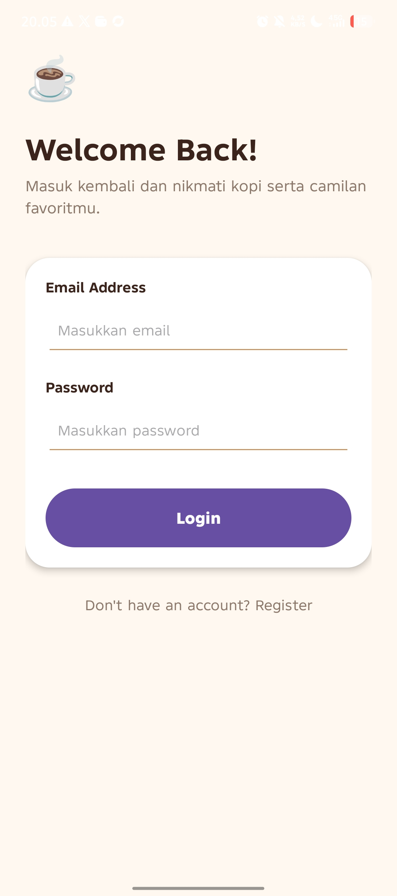
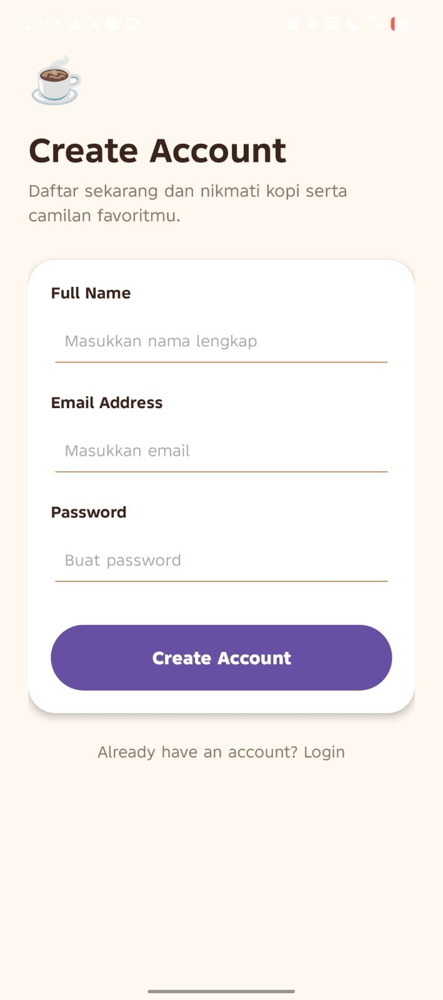
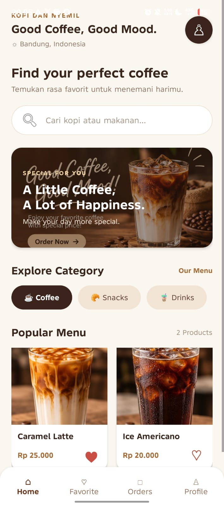
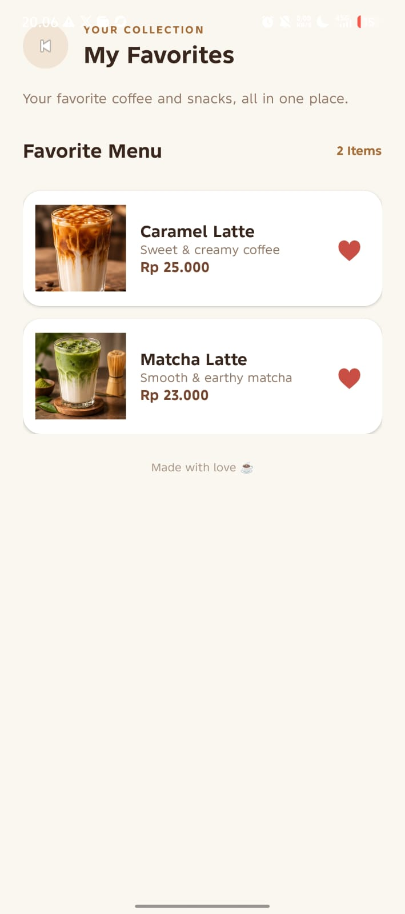
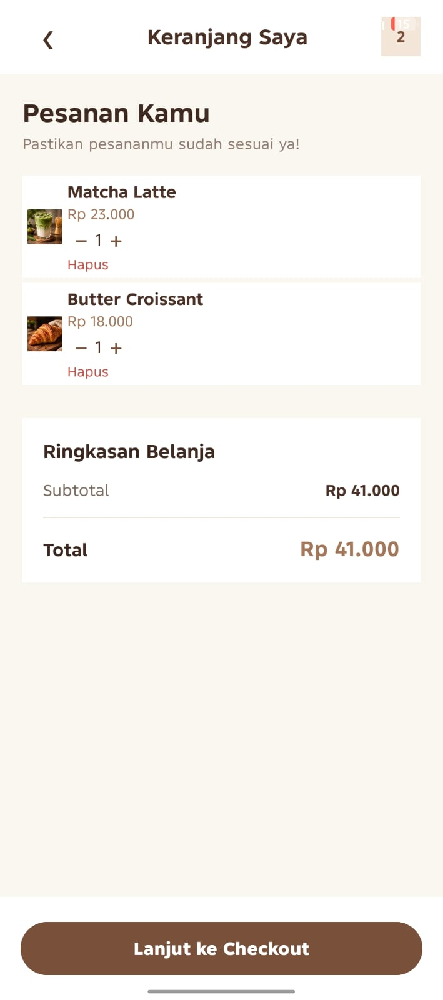
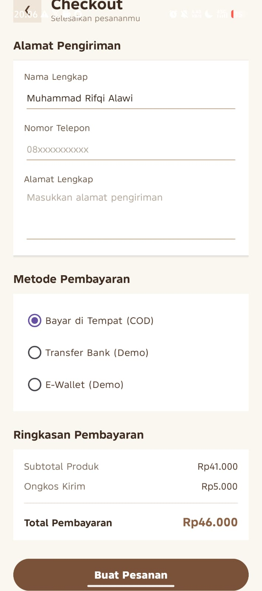
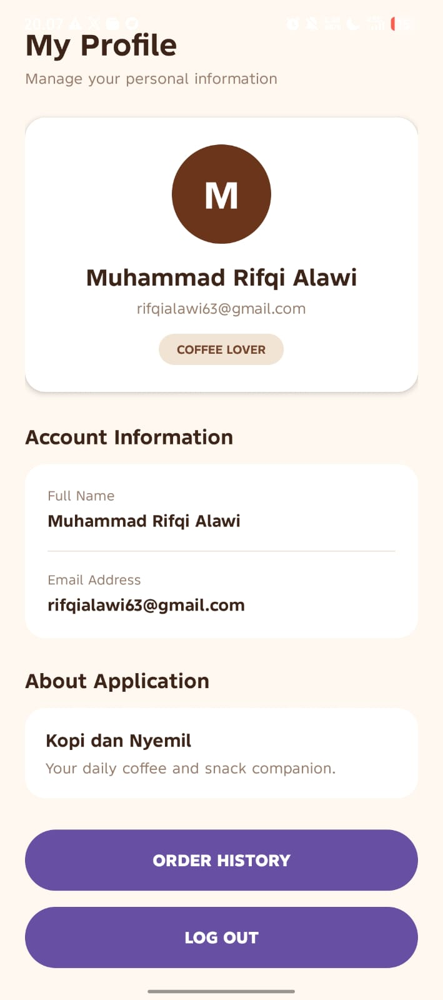

# Kopi dan Nyemil ☕

**Kopi dan Nyemil** adalah aplikasi pemesanan makanan dan minuman berbasis Android yang dibuat untuk memenuhi tugas UTS mata kuliah Pemrograman Aplikasi Mobile (PAM).

Aplikasi ini menyediakan berbagai pilihan kopi, minuman, dan makanan ringan dengan tampilan sederhana dan mudah digunakan.

## Fitur Aplikasi

- Welcome Page
- Sign Up dan Register
- Login
- Home dan daftar produk
- Pencarian produk
- Favorite
- Detail produk
- Shopping Cart
- Checkout dan alamat pengiriman
- Pilihan metode pembayaran
- Konfirmasi pesanan
- Riwayat pesanan
- Profile pengguna

## Daftar Produk

| Produk | Harga |
|---|---:|
| Caramel Latte | Rp25.000 |
| Ice Americano | Rp20.000 |
| Matcha Latte | Rp23.000 |
| Butter Croissant | Rp18.000 |
| Chocolate Donut | Rp12.000 |

## Teknologi yang Digunakan

- Bahasa pemrograman: Kotlin
- Layout: XML
- IDE: Android Studio
- Penyimpanan data: SharedPreferences
- Format data: JSON

Aplikasi menggunakan penyimpanan lokal pada perangkat dan tidak menggunakan database maupun server online.

## Cara Menjalankan Aplikasi

1. Clone repository atau download source code.
2. Buka project menggunakan Android Studio.
3. Tunggu proses Gradle Sync sampai selesai.
4. Hubungkan perangkat Android atau jalankan emulator.
5. Klik tombol Run untuk menjalankan aplikasi.

## Screenshot Aplikasi

### 1. Welcome Page

### 2. Sign Up

### 3. Login

### 4. Register

### 5. Home

### 6. Detail Produk

### 7. Favorite

### 8. Keranjang

### 9. Checkout

### 10. Konfirmasi Pesanan

### 11. Riwayat Pesanan

### 12. Profile

## Repository

https://github.com/Rifqi63/PROYEK_UTS_PAM

---

**Dibuat untuk memenuhi tugas UTS Pemrograman Aplikasi Mobile (PAM).**